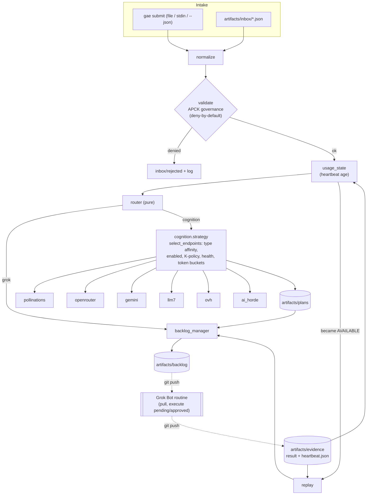

# Architecture

## Lifecycle (one `gae run --once` cycle)

1. **Governance integrity** — `governance.yaml` fingerprint must equal the one loaded at start
   (mutation disallowed → `GovernanceTamperError`, the agent stops).
2. **Intake** — every `artifacts/inbox/*.json` (sorted) is parsed.
3. **Normalize** — `{"task": {...}}` envelopes unwrapped; `type`/`action` trimmed/lower-cased.
4. **Validate** — `Task.from_dict` (strict) then APCK `validate_task`: task type (P), action
   allowlist (C), recursion depth (C), input size (C), governance mutation (C, always refused),
   human-approval flag (P). Rejected files move to `inbox/rejected/`.
5. **Route** — pure `route_task`: `requires_grok` → Grok always; `cognition_only_types` →
   cognition; Grok AVAILABLE → Grok; otherwise cognition with the per-type chain.
6. **Execute | cognition** — Grok: `BacklogEntry` written (the handoff). Cognition: strategy
   produces a `Plan` (advisory only) written to `artifacts/plans/`.
7. **Backlog** — immutable entry; human-gated actions start in `awaiting_approval`.
8. **Replay on AVAILABLE** — heartbeat is re-probed; if Grok is (or just became) AVAILABLE,
   evidence is reconciled (`pending|approved → in_progress → done|failed`) and outstanding
   Grok entries are re-dispatched in `(created_at, priority, entry_id)` order.
9. **Evidence** — `GrokResult` files + `heartbeat.json` written by Grok Bot.

## Grok Bot routine contract

1. `git pull`.
2. For each `artifacts/backlog/*.json` with status `pending` or `approved`, sorted by
   `(created_at, priority rank high<normal<low, entry_id)`: validate against
   `schemas/backlog_entry.schema.json`, do the work under Grok Bot's own governance, write
   `artifacts/evidence/<entry_id>.json` (`schemas/evidence_result.schema.json`).
3. Never execute `awaiting_approval`, `rejected`, `done` or `failed` entries.
4. Write `artifacts/evidence/heartbeat.json` (`schemas/evidence_heartbeat.schema.json`).
5. Commit + push evidence only.

## Determinism

Injected clocks (`Orchestrator(clock=)`, `TokenBucket(clock=)`, `HealthTracker(clock=)`),
hash-derived entry ids, pure router/usage transitions, sorted inbox and backlog iteration,
`temperature: 0`. LLM text remains non-deterministic and is confined to `Plan.raw_text`.

### Evidence contract addition (doctrine, 2026-10-11)
When a backlog entry has a plan, Grok's result `outputs.evidence` must map each
`evidence_required` step index (as a string) to a non-empty file under `artifacts/`, e.g.
`{"evidence": {"1": "artifacts/evidence/<entry>/step1.md"}}`. A `done` result without it is
reconciled as FAILED (see docs/doctrine.md).
